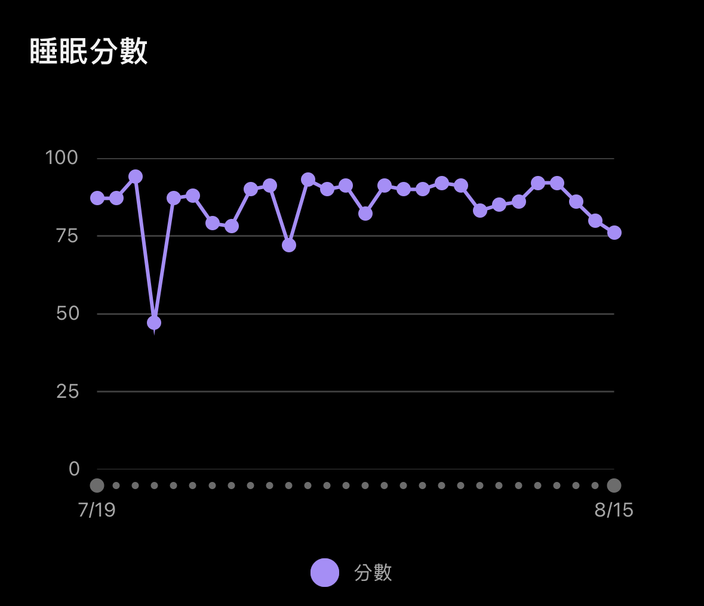
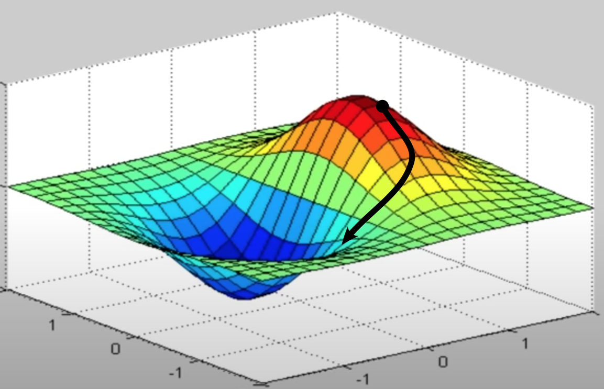

## 前言

最近順利過了 Probation Review，覺得是個很好的 Check Point 回顧從入職到現在大約四個月左右的一些心境轉變或想法，大概不會提到太多工作內容。因為我的想法常常東一塊西一個，強迫自己寫一篇文章梳理一下，也讓我試圖經營一下這個部落格。

## 初期的掙扎

我是以 Data Engineer 的職稱加入團隊的。老實說，這是個找工作時完全沒想過的 title，綜觀我在 [2026 New Grad 軟體求職心得](/posts/2026-job/) 面試的公司，不外乎都是 Backend / DevOps / SRE Engieer，看得出來自己內心深處應該是對平台層級的系統開發相當有興趣。但或許是當初想趕快上岸的心，覺得現職公司在自己在意的各個面向中都能接受，就決定先去了（題外話，站在現在來看，當初可能也沒必要那麼急躁，把預計要面的公司慢慢面完再作決定也不遲）。

或許是 title & 工作內容跟自己預期的不太一致，其實入職後蠻痛苦的。還不確定自己能幹嘛 + 不熟悉環境 & 同事，我還記得第一週我被拉近某個專案會議，是一個 Databricks 專案的會議，所有 Data 相關專業名詞大概都沒聽過，唯一會做的是 Github CI/CD，我想說欸幹，我怎麼在這裡啊？

那個晚上壓力大到 Garmin 手錶的睡眠分數超差，順便測試了 Garmin 的睡眠分數沒有亂算：

回到對這份工作的掙扎，我自己覺得掙扎的點有幾個：

- 急著想證明自己  
  我覺得其實這難免，新人都會想要在各種面向證明自己是可造之材。但我因為這樣讓自己太緊繃了，非常怕犯錯或問問題的感覺。
- 期待工作能帶給我全部  
  第一份正職工作，我想要工作能帶給我極致的成長，最好給我最難的 case、最有趣的 feature、最能學到東西的 project，最好是能讓我極短時間獲得大幅成長。
- 想像與現實的差距  
  或許是上一份實習讓我看到還不錯的 Software Engineering Practice，讓我對純軟公司充滿期待；也或許是 AI 發展太過快速，大家想要加速交付的流程，當我發現團隊目前的開發模式並沒有照著我以為的好的 Practice 走，難免會覺得心理怕怕的，產生像是：「疑，原來現在的業界慣例是這樣嗎？」的困惑。

我希望自己每天上班心情都好，所以我試圖在說服自己要喜歡上這份工作，接受所有我覺得跟一開始想的不一樣的地方。

這會非常難受，一方面是我害怕就這樣偏離了自己的職涯方向；另一方面，這個地方就不是這個樣子的嘛！（這樣講好像有點讓人覺得：「哦～ 所以整個團隊你最清醒，只有你想到這些？」。但我並不是在說團隊或公司不好，大家都很強，一定都想要朝著好的方向走，但更多的應該是時空背景之下的權衡，我完全能理解。）

## 心態的轉變

以我來說，我們 team 負責某些營運指標從訂單系統到最終數字的邏輯計算，我對這些 business metrics 說實在一點興趣都沒有，但我更想要投入到打造一個 robust 的 ETL Pipeline / Data Platform，這所帶來的成就感讓我上起班來是開心的。幸好我們 Team 有非常強的 Data Analytics handle 掉了幾乎所有的 business logic 相關任務，讓我至少在職涯方向上沒有完全偏離我想做的事。有這個 awareness 自己覺得蠻關鍵的，這會給我一種還在賽道上的信心。

當然這陣子也看了很多文章，跟女朋友抱怨，和 AI 大聊特聊。絕對沒有完全停止焦慮，但好像慢慢有一個自己能接收的想法：「我不再強迫自己要喜歡上現在這份工作，而是想辦法在完成任務之餘，試著**抓一點自己想要的東西**起來。」

學生時代，找到一個正確答案後，就直線朝著那個方向前進就好，但我覺得追尋人生答案的過程可能比較像是 Gradient Descent，探索的過程是跌宕起伏的，如果有這個認知，往後遇到各種無法接受的事，應該就不會太痛苦了。（我就是喜歡幫自己寫這種心靈雞湯）

## 之後呢

最後回到這篇文章的主題，帶著這些心靈上的掙扎結束了 Probation Review，之後呢？

我覺得近期還是容許自己探索的時間和空間，應該是不會隨便就離職閃人（笑 ，一方面在工作任務上繼續展現自己的 ownership，另一方面持續吸收自己有興趣的職涯方向，保持對工作和職涯的彈性，並且好好過生活，這樣對 25 歲的我來說就足夠了吧 :)

> 你不需要一直證明自己正在前進，才能允許自己對現況感到安心。
> 
> 職涯是一段很長的過程。你可以保持企圖心，但不必把每一次卡關、每一週的低成長感，都解讀成自己正在浪費時間。
